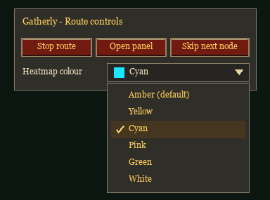
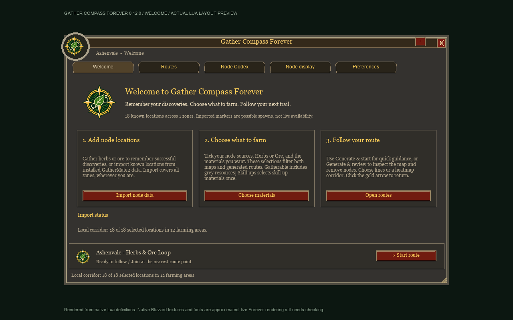
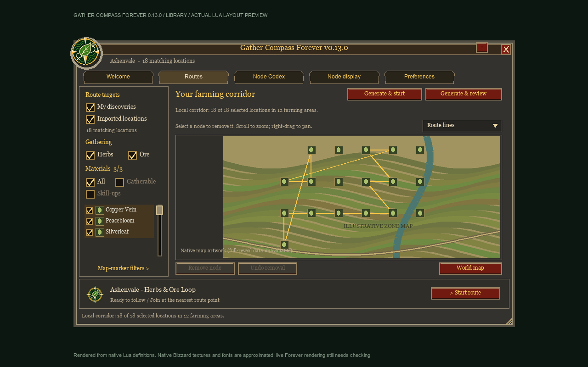
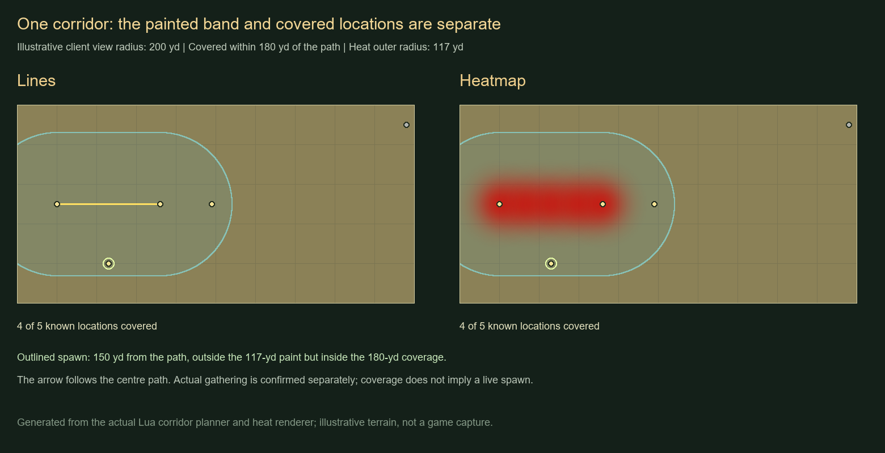
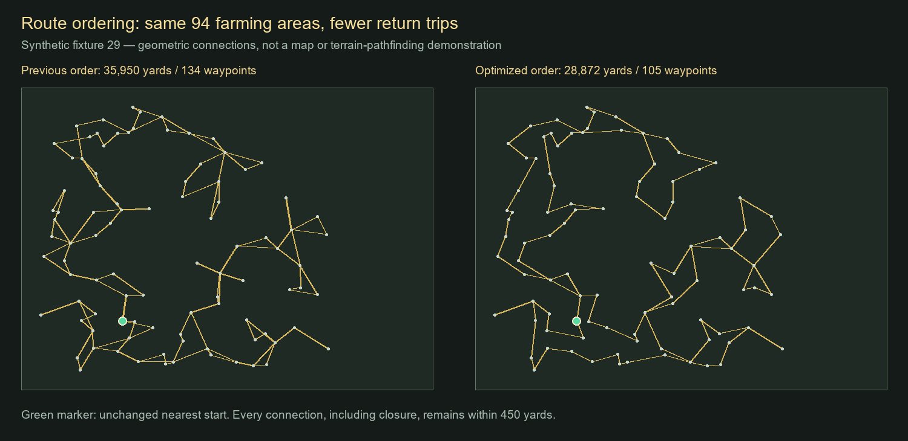
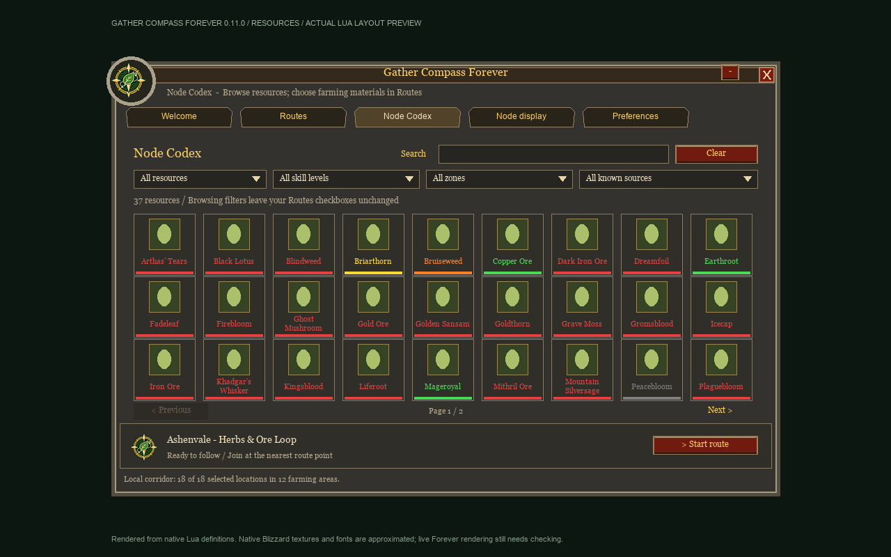
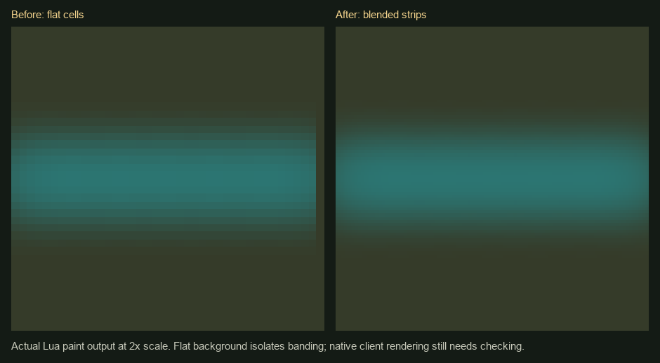
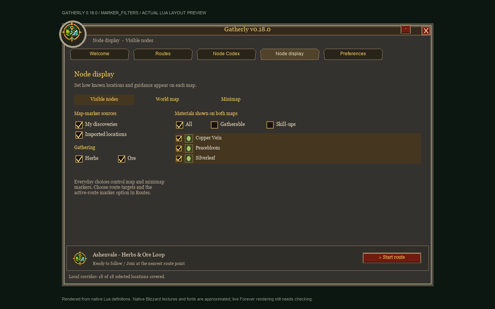
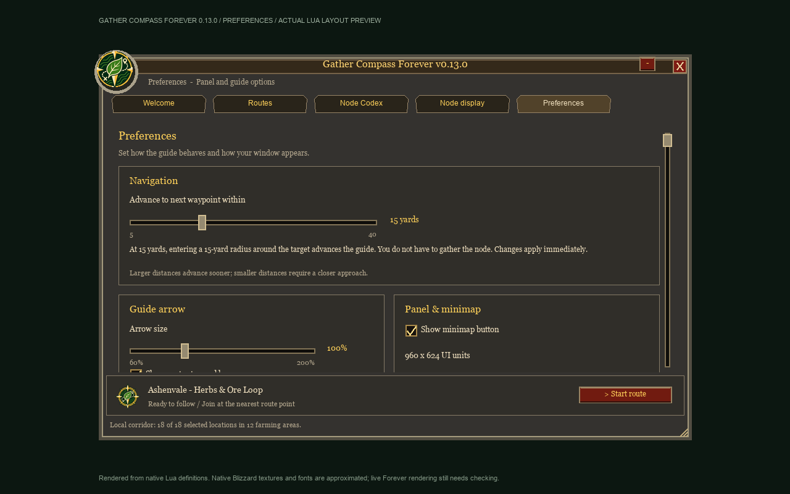

<p align="center">
  
</p>

# Gatherly

A gathering companion for **WoW Forever**: remember herb and ore locations, discover
where resources grow, build farming routes and follow a clear in-game guide arrow.

[Download the addon](https://github.com/Red463/Gatherly/releases/latest) |
[Report a bug](https://github.com/Red463/Gatherly/issues) |
[Changelog](CHANGELOG.md) | [Contributing](CONTRIBUTING.md)


**Current version:** 1.1.1 | **Client interface:** 16001 | **Command:** `/gatherly`

## What it does

- **Remember your discoveries.** Record a known location after a successful gather,
  keeping personal history separate from imported data.
- **Import all zones.** Read installed GatherMate2_Data directly, with GatherMate2's
  saved observations as a fallback. Repeated imports merge matching locations.
- **Choose what to farm.** Filter by source, herbs/ore and individual materials, with
  independent map-marker and route-target checkboxes, scrolling lists and
  one-time Gatherable (including grey) or Skill-ups material selection.
- **Generate a local corridor.** Start immediately, or review a large zone map and
  remove individual nodes with undo. No save step is needed.
- **Route around restricted terrain.** Bundled masks cover all 55 local maps in
  Forever build 70959. Travel waypoints lead around restrictions; joining,
  skipping and Codex guidance use the same masks. Stepping outside a mask does not
  interrupt the arrow; it continues towards the current waypoint. Swimming and return trips are allowed.
- **Follow the path.** Choose thin lines or a soft heatmap corridor on the world map
  and route sketch, plus minimap heat. A smooth gold arrow guides the same route. Optionally show the next resource, waypoint progress and lap number.
- **Remember detour pickups.** Confirmed gathers skip a matching later stop for the
  current lap, then become eligible again next lap. Passing nearby does not count.
- **Keep route-session history.** Record all gathering from route Start until
  Stop, including detours and pauses. Stop opens a saved summary with successful
  gathering actions, received item quantities and optional Auctionator valuation.
  History shows only the logged-in character's sessions.
- **Explore Node Codex.** Browse skill-coloured item tiles, compare zones and skill
  requirements, and review a resource route or guide to a nearby known location.
- **Read crowded maps.** Shared count badges group overlapping icons; hover for a
  resource breakdown. Minimap outlines retain their original spawn positions.
- **Tune map markers.** Visible nodes chooses everyday markers; World map/Minimap pages control sizes, opacity,
  grouping and nearby-icon hiding without losing hollow outlines.
- **Choose a panel size.** Select Small, Standard or Large in Preferences. Each layout
  gives the map and lists appropriate space while keeping normal text and controls unchanged.
- **Review without losing history.** Removals affect the current plan only. Existing
  saved routes and node history are preserved. A minimap badge opens the panel.

### Floating route controls

Starting guidance opens a compact Classic toolbar with **Stop**, **Open panel** and
**Skip >**. Drag its Gatherly heading to move it; its position is remembered.
It remains available while paused and closes when the route stops or finishes.
Click the **colour swatch** to choose Amber, Yellow, Cyan, Pink, Green or White for the
minimap terrain. The colour swatch shows your selection, which applies immediately
to both Lines and Heatmap and is remembered. Amber is the default colour. World-map colours and opacity
settings are unaffected.
Untick **Show route controls** on the **Routes** page to disable it. The arrow and
route guidance continue normally.



### Route sessions and History

A gathering session begins when a route starts and ends only when you press
**Stop**. It includes herbs, ore and bonus materials collected on detours, while
paused and across multiple laps. Replacing guidance keeps the same open session.
Guidance completing does not end the session. After a reload, the session remains
open and Stop is still available even though guidance itself is not restored.

Stop opens **History** with that session selected. The summary shows the starting
route and zone, date, duration, successful gathering actions and received item
quantities. Opening a loot window alone does not count its items. Several mining
actions can come from one vein, so gathering actions and item totals are separate.
Only the logged-in character's sessions appear. Existing sessions from before this
feature cannot be reconstructed.

With Auctionator installed, Stop saves its available item prices and an
**Estimated auction value**, before auction fees. Unpriced items are excluded
from the value and identified as missing prices. Without Auctionator, the value
section is omitted. Historical summaries retain their saved prices when the
auction market changes. Recorded sessions are not automatically discarded.

## Install

Gatherly uses the **Gatherly** folder, **Gatherly.lua** saved-data file and
**GatherlyDB** global. The only slash command is **/gatherly**.

1. Download `Gatherly-1.1.1.zip` from
   [Releases](https://github.com/Red463/Gatherly/releases/latest).
   Choose the addon ZIP asset rather than GitHub's automatic **Source code** ZIP.
2. Close WoW and extract the `Gatherly` folder into your Forever
   client's `Interface/AddOns` directory.
3. Check that the final path is
   `Interface/AddOns/Gatherly/Gatherly.toc`.
4. Restart WoW, enable **Gatherly** in the AddOns list, then type
   `/gatherly` or click the compass badge beside the minimap.

Manual route creation, recording and the saved-route list are no longer exposed.
Existing saved routes remain in your SavedVariables.

Terrain routing uses the final Ashenvale rules: a 50-degree slope cutoff,
removal of isolated one- or two-cell blocked patches, and filling enclosed
walkable pockets. Twelve maps have missing terrain sections; these remain blocked.
Terrain masks do not describe buildings, bridges, caves or every collision object,
so routes still need checking in the client. Planning stays local and can omit
disconnected or distant nodes. No external tool or player-drawn overlay is needed
to use the addon. See [terrain data and routing](docs/terrain-routing.md).

When updating Gatherly, replace the complete addon folder. **Keep SavedVariables**
to retain routes, known locations and preferences. The addon is built for Forever's
interface 16001; other WoW clients are not currently supported.

### Transfer existing saved data once

The renamed addon reads `GatherlyDB` from `Gatherly.lua`. It does not register
aliases for previous addon identities. To retain existing nodes, routes and settings:

1. Close WoW and back up your account's `WTF` folder.
2. Copy your existing addon's saved-variable `.lua` file to a working directory.
   Choose the file containing its nodes, routes and settings.
3. Download [transfer_saved_data.py](https://github.com/Red463/Gatherly/releases/latest/download/transfer_saved_data.py)
   from the same release and run it with Python 3:

   ```text
   python transfer_saved_data.py "path/to/saved-data.lua" "path/to/Gatherly.lua"
   ```

4. Put the new `Gatherly.lua` in the same account's `SavedVariables` directory,
   before launching Gatherly for the first time. If a Gatherly save already exists,
   back it up before choosing which save to use; the tool refuses to overwrite files.
5. Remove the superseded addon folder from `Interface/AddOns`, install the `Gatherly`
   folder, restart WoW and verify your nodes and preferences.

The tool validates serialized table data, then changes only the root variable name.
It rejects malformed fields and executable expressions before creating output. It
never executes Lua or changes the input file; stored data, comments, encoding marker
and formatting are preserved. Transfers are optional:
Gatherly can also start with an empty database and import node locations normally.

### Optional node data

Install the **Forever-compatible** versions of GatherMate2 and GatherMate2_Data,
then open **Welcome** and click **Import node data**. This is the only import button.
The data pack declares GatherMate2 as a dependency,
so keep both enabled even though this addon reads the pack directly.

Importing covers all available zones regardless of your location or route filters.
Imports run in short per-frame slices and use a temporary spatial index for duplicate
checks. Repeat imports reuse matching locations without changing personal gather
counts, dates or positions. Progress updates while work runs; completion refreshes
the panel and maps immediately. No persistent index or database migration is needed.
No spawn dataset is included in this repository. Normal personal recording works
without an external data pack.

## Image examples

The interface examples are **in-game screenshots supplied by the author**, captured
with Gatherly **v0.18.6** on WoW Forever. The visible version labels and settings are
unchanged; the current release may differ slightly. The explanatory diagrams below
illustrate coverage, route ordering and heat rendering; they are not game captures.

### Welcome and route targets

Welcome introduces the workflow, imports all available zones and shows import status.
It appears on first use; **Choose materials** in step 2 opens the Routes checkboxes.
Guide-arrow clicks still open Routes directly.



The Routes sidebar is labelled **Route targets** and controls new routes and their
review sketch. Everyday map markers have separate selections under **Node display >
Visible nodes**. Both use source/type checkboxes and skill-coloured materials. The route material list supports mouse-wheel
scrolling and a scrollbar, with icons and skill-coloured names.

### Generate and review

Choose materials, then use **Generate & start** or **Generate & review**. Click a node
to select it, then **Remove node** to update the corridor. **Undo removal** restores
it. Scroll to zoom and right-drag empty map space to pan. Dim icons are outside the
current local circuit; counts show the included and omitted locations. Revealed
map overlays are loaded from the client using attributed MIT metadata. If an art ID
is not covered, the sketch falls back to native explored artwork. No OpenMap addon
is required.



The generator optimizes the order of the current farming areas to reduce crossings
and repeated travel, then simplifies the centre path while keeping those locations
within its coverage distance. Zoom the minimap fully out before generating a new
route. Coverage is 90% of the actual radius reported by the client at that zoom,
shown in yards in Routes. It is measured on either side of the whole path, including
between waypoints and around the closing leg.

A covered known location can sit outside the narrower painted heat band. Coverage
does not imply a live spawn or a successful gather. The arrow follows the centre
path; detour when you find a resource. Lines and Heatmap share the same path and
coverage. The nearest starting anchor and 450-yard connection limit remain.

Changing minimap zoom later does not change the plan or counts. Routes and the
arrow remind you to zoom fully out. If the live range becomes smaller than the
saved coverage, a reduced-range reminder appears; the plan stays unchanged.
Removal/undo keeps the captured coverage range;
a new generation measures it again. Existing active routes are preserved until
you replace them. Direct **Guide nearest** in Node Codex still targets that resource
location and does not require corridor calibration.

*Mechanics diagram: covered nodes can sit outside the painted heat band.*



Some return trips remain necessary where a farming branch has only one short
connection. Routes use map distances and cannot identify mountains, bridges or
walkable roads from spawn coordinates.

*Mechanics diagram: a synthetic example of route-order optimization.*



### Overlapping nodes

Badges show the number of known locations and the most common resource's icon.
Ties use a stable icon choice. Hover for a compact list of skill-coloured resource
names and counts. Zoom in to separate nearby locations.
In the Routes sketch, click a badge and choose one member before using **Remove node**;
the other members and stored history stay intact. Grouping can be disabled per map.
Exactly coincident review nodes still open the chooser so every member remains selectable.

### Detour pickups

New corridor routes guide through travel points and do not require harvesting at
each covered location. Passing one never records a gather. Successful gathers
still update personal history normally, and optional detours do not become later
mandatory resource stops.

For existing gather-stop routes, the following pickup memory is retained:

Successful gathers with matching loot mark the nearest compatible planned stop
within 15 yards of your interaction position as collected for this lap. The guide
skips that stop later, in either Lines or Heatmap mode. Other resources and nearby
spawns remain eligible. This is separate from your waypoint arrival distance.

Pickup memory survives pause, rejoin, reverse and node removal/undo in the same
route. A new lap, fresh start or new generation resets it. The corridor artwork
keeps its original geometry; the arrow and destination highlight identify the next
required stop. Explicit travel waypoints remain, and a collected stop may serve as
a travel waypoint when bypassing it would exceed the route's connection limit.
Stored node locations and history are preserved.

### Node Codex

Node Codex combines the previous Atlas and Resources pages. Browse the full supported
catalogue with type, skill, source and zone filters plus name search. The tile grid
and ranked-zone list scroll vertically; search and column headers stay visible.
Back restores your previous scroll position. Tiles show the
best skill-up state among currently gatherable sources; scoped results use only
sources with matching locations. The unrestricted catalogue includes all supported
sources. Details show every source's own requirement and colour. Unknown data stays neutral.

Codex browsing does not rewrite Routes checkboxes. Current-zone route/nearest actions
use the selected resource intersected with those checkboxes, and preserve active
guidance until it is stopped. Coordinate tables and the redundant Welcome button
have been removed. Map buttons are available only when matching locations also pass
the effective map-marker selections and world-icon opacity is above zero. Disabled
actions identify an active route override or the opacity setting when relevant.
Items without location data remain in the default full catalogue.



### Heatmap corridor

Select **Heatmap corridor** above the route sketch to replace the lines with a darker,
soft red band through the generated farming areas. It is a route view, rather than a
live resource scanner. The arrow follows the same points; switching views does not
regenerate the route. Heat also appears on the minimap in brighter amber/gold to stand
out over dark terrain, replacing its route lines,
while resource markers and the destination marker remain. Its bounded transparent
field keeps small feathered clearance around the player and current destination.
Minimap heat uses thin blended strips to reduce square patches and hard opacity
bands. The renderer reuses a bounded texture pool and supports both gradient APIs;
builds without either gradient API use a finer flat-strip fallback.
Recurring refreshes reuse the heat field's scratch arrays, strip records and
gradient colours. World-marker work pauses while that map is closed, and minimap
distance/grouping work is restricted to nearby nodes. Marker selections are cached
until the data or filters change; opening the world map refreshes it immediately.
It no longer cuts holes around every possible spawn. Thin route lines retain their
known-node clearance. Native unknown live
blips are not enumerable, so check tracking contrast in your client. Unsupported
custom minimap shapes hide heat rather than spilling outside the map. When Forever
ignores minimap rotation, an addon-owned projection keeps icons, outlines and the
destination aligned with the heat without modifying the shared pin library.


*Rendering diagram: heat blending over a flat test background.*



### Guide arrow

The gold arrow rotates smoothly. Enable **Show next node name** and **Show route
step and lap** in Preferences when useful. New centre-path guidance displays
**Farming corridor** when the name option is enabled; direct resource guidance and
legacy gather stops retain their resource names. Click the arrow to reopen the route panel;
dragging it moves the guide instead. Starting a route closes the panel automatically.

The waypoint arrival distance in Preferences applies immediately to the current
route. Guidance waits during gathering; nearby overlapping stops retain movement
protection so a stationary player cannot repeatedly advance through a loop.


## First farming loop

1. Gather a few nodes or import node data from **Welcome**.
2. In **Routes**, tick your node sources, gathering types and materials.
3. Click **Generate & start** for quick guidance, or **Generate & review** to inspect it.
4. In review, select unwanted nodes and use **Remove node** or **Undo removal**.
   Choose **Route lines** or **Heatmap corridor**, then **Start route**.
5. Follow the arrow. Pause, skip or stop through the panel; click the arrow to reopen it.
   Resume rejoins nearby and leaves guidance paused if the farming area is too far away.

Path overlays appear while following (including when paused) or reviewing the current
plan. Stopping or completing guidance clears them. Generation starts at the nearest
selected local node and builds connected farming areas, rather than forcing a whole
zone into one circuit. The displayed counts show when other areas are omitted.

**Node Codex** offers ranked zones, personal history, skill-coloured sources and
current-zone resource guidance in one page. Clicking a ranked zone focuses that
resource on the world map, subject to the effective map-marker filters. Closing the map
restores its usual display.

## Settings and commands

| Command | Action |
| --- | --- |
| `/gatherly` | Open or close the panel |
| `/gatherly import` | Import available herb/ore data across all zones |
| `/gatherly skip` | Skip the current waypoint |
| `/gatherly stop` | Stop route guidance |
| `/gatherly status` | Show current status and capability/storage messages |
| `/gatherly inspect` | Arm a one-shot native herb/vein tooltip capture |
| `/gatherly inspect report` | Show the latest local capture |
| `/gatherly inspect off` | Cancel a pending capture |
| `/gatherly trace` | Start a local guidance diagnostic history |
| `/gatherly trace report` | Stop recording and open a report you can copy |
| `/gatherly trace off` | Stop tracing and keep its saved history |

If the arrow disappears or reconnects unexpectedly, start `/gatherly trace`,
follow the route until it happens, then use `/gatherly trace report`. Press
**Ctrl+A**, then **Ctrl+C** in the report window to copy it into a bug report.
It records up to 40 state changes, including safe position-read failure reasons,
zone/coordinates, mask cells, path-search/facing failures, waypoints and direction.
Repeated identical failures are combined. Tracing is off by default, produces
no continuous chat output, and stops on opening the report or reloading.
The latest report remains in SavedVariables; starting another trace replaces it.

**Routes > Route targets** controls new route generation and the review sketch.
Changing these choices does not change everyday map markers or interrupt the current
route. Regenerate when you want the new choices applied to guidance.

**Node display > Visible nodes** controls ordinary world-map and minimap markers
across all zones. Marker-only users can configure everything here without generating
a route. Sources, gathering types and material selections are independent of Routes.
Existing shared preferences are copied into both sets on upgrade; explicit empty
selections are retained. Importing canonical GatherMate IDs preserves personal-name
material selections, independent exclusions and active guidance snapshots.

In **Routes**, optionally enable **Only show route target nodes during an active route**.
Both maps then use the
active guidance's saved filter snapshot, including while paused or suspended.
Changing the sidebar mid-route does not rewrite that snapshot. Stop/completion
restores everyday markers without overwriting their preferences. The Visible nodes
page identifies when the override is active. It is off by default.



In either set, unticking every source or gathering type gives no matching nodes;
this does not reset your choices. Marker filters do not hide the route overlay,
destination or arrow.

**All** selects all materials; untick it to clear the selection. **Gatherable** selects
known resources your current skill can gather, including grey resources and capped
professions. **Skill-ups** selects
known orange, yellow and green materials across matching known zones once. It excludes
grey, too-difficult and unknown resources, and you can edit the result afterward.
The selected materials do not change automatically when your profession skill rises.

**Node display** has **Visible nodes**, **World map** and **Minimap** pages. Configure icon
sizes/opacities and grouping on each map; minimap outlines have their own size and
opacity. The nearby-hide distance affects icons/counts, while hollow outlines stay
at their real known positions. Each map has separate **Line opacity** and
**Heatmap opacity** sliders; world-map heat defaults to 50%. The Routes sketch follows the world-map values.
The minimap's **Show route overlay** switch enables either style independently
of node-marker visibility. Zero opacity hides that overlay without changing
coverage, guidance or markers. Existing minimap opacity seeds both new minimap
values; world values begin at their previous full strength.

**Preferences** groups Navigation, Guide arrow and Panel & minimap controls.
**Advance to next waypoint within** sets a radius: at15 yards, entering a15-yard
radius advances the guide without requiring a harvest. Larger values advance sooner;
smaller values require a closer approach. Changes apply immediately. Gathering and
overlapping-stop movement safeguards still apply.



The title bar includes the installed addon version (including prerelease metadata).
The header shows the complete supplied badge inside the native portrait frame.
The minimap launcher fits the complete badge inside the standard native minimap
border, with artwork that follows the collector's button size.
It follows EQoL Button Sink's position, size and visibility while collected, and
requests discovery when shown again or when the minimap/collector becomes available.
EQoL's disabled-sink and ignored-button settings remain respected.
Dragging around the minimap resumes when the collector releases it. The Gatherly
visibility preference still hides the launcher in either location.
Use `/gatherly` to reopen the panel when its minimap button is hidden.

### Panel size

Use **Preferences > Panel & minimap > Panel size** to choose a fixed layout:

| Size | Width x height (UI units) |
| --- | --- |
| Small | 960 x 680 |
| Standard (default) | 1100 x 780 |
| Large | 1240 x 880 |

The route map grows with the layout while keeping its artwork proportions and
aligned nodes, lines and heat. Lists show more rows where space allows; smaller
layouts use interior scrolling. Normal text, buttons and icons keep their sizes.
The corner resize grip has been removed. **Reset panel size** chooses Standard.

Saved custom dimensions migrate to the nearest preset, preserving position. If a
choice does not fit the current screen, the addon temporarily uses the largest
smaller preset that fits and explains this in Preferences. Only screens too small
for Small scale down the whole panel. Your preferred choice returns when space is
available. These sizes use WoW's UI coordinates, rather than physical monitor pixels.
Minimising preserves the preset; guide-arrow size remains independent.

## How to read the data

Known locations are **possible spawn points**, not a live node scanner. Zone
rankings reflect your imported/recorded data. Personal and imported location counts
can overlap; personal gather counts are successful interactions, not item quantities.
Recorded coordinates reflect the interaction position, which can differ from the
object's exact centre.

Skill colours use the **Mastercraft 2.0.7 reference model** for supported resources:
yellow at required skill +25, green at +50, and grey at +100. This includes starter
nodes: requirement 1, yellow 26, green 51, grey 101. Orange reads “Always a skill-up,”
yellow “Usually a skill-up,” and green “Sometimes a skill-up.” These are reference
descriptions, not verified Forever percentages. Current profession rank and readable
cap/bonus information still apply. A confirmed missing profession is red with Learn Mining or
Learn Herbalism guidance. Failed/incomplete queries and unreadable ranks remain
neutral. Native tooltip inspection
is optional, stored locally and does not automatically change the skill rules.

Routes use nearby spatial groups and geometric connections of at most 450 yards,
including their return path. Dense areas use representative actual spawn locations;
the arrow does not visit every candidate individually. Disconnected or distant
areas are omitted rather than joined across the zone.

Bundled zone masks guide terrain-aware connections around restricted cells, with
travel bends retained by the arrow and both route styles. The masks describe
two-dimensional terrain passability; they do not model every building, cave or
dynamic obstacle. Swimming and necessary return trips are allowed. Move around an
unmapped obstacle, skip a difficult destination, remove an unwanted node, or
regenerate from a better position. Routes are single-zone and their inputs/visuals are
bounded for performance. Entering a waypoint's arrival radius
can advance the route without a harvest. The addon does not move your character or
gather automatically, and it does not replace your native waypoint.

The current build has automated behavior/package checks and is ready for client
testing. Those checks do not prove native rendering or restricted API behavior.
Report a Lua error with the addon version, client build, zone and steps to reproduce.

## Development

See [Contributing](CONTRIBUTING.md) for setup, checks and artwork guidance.

```sh
python -m pip install -r requirements-dev.txt
python tests/run_tests.py
python tools/package.py
python tests/package.py
python tools/check_publication.py
```

Tests use Lua 5.1 through Lupa. The installable archive is generated in `dist/`;
it is not the same as GitHub's source archive. The installed addon makes no network
requests and needs no external service.

For the first CurseForge upload, build the ZIP, then run
`python tools/prepare_curseforge_release.py` and `python tests/curseforge_release.py`.
The [submission brief](https://github.com/Red463/Gatherly/blob/main/docs/curseforge-release.md)
lists the generated icon, Markdown description, changelog and upload fields.

## License

Gatherly's original code, documentation and project artwork are
licensed under the [MIT License](LICENSE). The pinned OpenMap reveal metadata is
also MIT and retains its own notice. Bundled third-party libraries retain
their original licenses; see [Third-party notices](NOTICE.md).

World of Warcraft and referenced native UI artwork belong to Blizzard Entertainment.
This is a community addon and is not affiliated with or endorsed by Blizzard.
