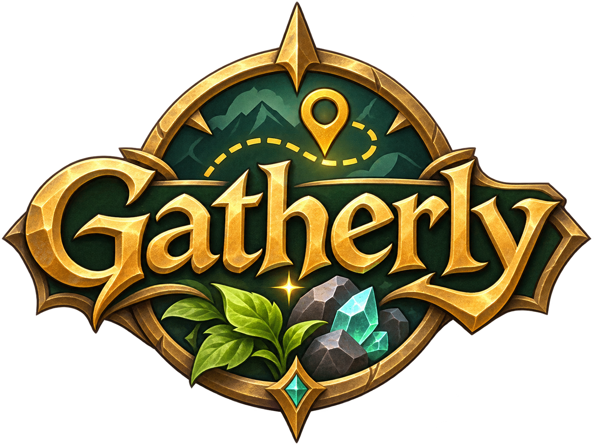
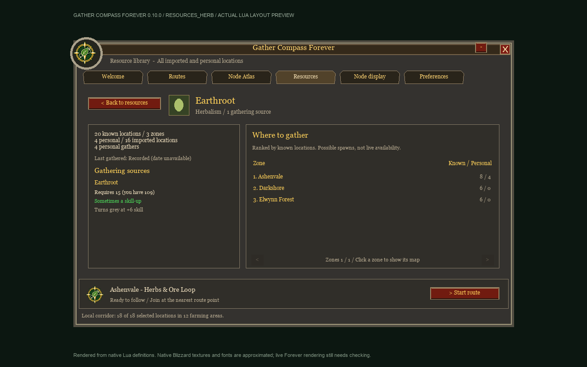
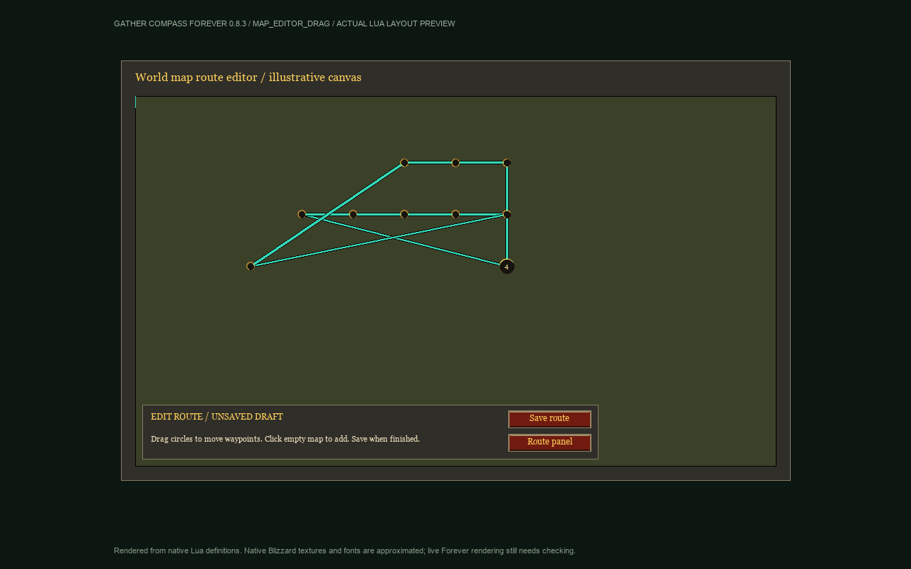

<p align="center">
  
</p>

# Gather Compass Forever

A gathering companion for **WoW Forever**: remember herb and ore locations, discover
where resources grow, build farming routes and follow a clear in-game guide arrow.

[Download the addon](https://github.com/Red463/GatherCompassForever/releases/latest) ?
[Report a bug](https://github.com/Red463/GatherCompassForever/issues) ?
[Changelog](CHANGELOG.md) ? [Contributing](CONTRIBUTING.md)


**Current version:** 0.8.7 ? **Client interface:** 16001 ? **Command:** `/gcf`

## What it does

- **Remember your discoveries.** Record a known location after a successful gather,
  keeping personal history separate from imported data.
- **Import all zones.** Read installed GatherMate2_Data directly, with GatherMate2's
  saved observations as a fallback. Repeated imports merge matching locations.
- **Choose what to farm.** Filter by source, herbs/ore and individual materials, with
  skill-coloured material names and icons.
- **Build routes your way.** Generate a resource-based loop, draw a custom route,
  record a travelled path or drag existing waypoints on the world map.
- **Follow the path.** World-map lines, minimap guidance and a smooth gold arrow show
  the way. Optionally show the next resource, waypoint progress and lap number.
- **Explore resources.** Browse a square item grid and view zones ranked by known
  node count, source-specific skill requirements and personal gather history.
- **Tune map markers.** Use icons on the world map and icons, rings or squares on
  the minimap. Hide nearby minimap icons while retaining hollow outlines.
- **Manage saved routes.** Use descriptive generated names, edit existing routes or
  delete one through a named confirmation. A draggable minimap badge opens the panel.

## Install

1. Download `GatherCompassForever-0.8.7.zip` from
   [Releases](https://github.com/Red463/GatherCompassForever/releases/latest).
   Choose the addon ZIP asset rather than GitHub's automatic **Source code** ZIP.
2. Close WoW and extract the `GatherCompassForever` folder into your Forever
   client's `Interface/AddOns` directory.
3. Check that the final path is
   `Interface/AddOns/GatherCompassForever/GatherCompassForever.toc`.
4. Restart WoW, enable **Gather Compass Forever** in the AddOns list, then type
   `/gcf` or click the compass badge beside the minimap.

When updating, replace the complete addon folder. **Keep SavedVariables** to retain
routes, known locations and preferences. The addon is built for Forever's interface
16001; other WoW clients are not currently supported.

### Optional node data

Install the **Forever-compatible** versions of GatherMate2 and GatherMate2_Data,
then click **Import node data**. The data pack declares GatherMate2 as a dependency,
so keep both enabled even though this addon reads the pack directly.

Importing covers all available zones regardless of your location or route filters.
No spawn dataset is included in this repository. Normal personal recording works
without an external data pack.

## Image examples

These are **layout previews rendered from the addon's Lua UI**, with substitute
fonts, placeholder resource icons and an illustrative map canvas. They are not
in-game screenshots; actual Forever textures and rendering can differ.

### Route library

Choose materials, preview a saved circuit, then edit, open its map, delete or start it.


### Resource catalogue and details

Filter the full supported item catalogue by type or name. Click an item to compare
its known zones and read gathering requirements. Items without known locations
remain visible so you can plan what to seek next.




### Editing waypoints

**Edit path** opens the route's map. Drag a gold circle to move a waypoint, click
empty map space to add one, then use **Save route** or **Route panel**. The saved
route stays unchanged until you save. Numbers appear on selected or hovered handles.



### Guide arrow

The gold arrow rotates smoothly. Enable **Show next node name** and **Show route
step and lap** in Preferences when useful. Click the arrow to reopen the route panel;
dragging it moves the guide instead. Starting a route closes the panel automatically.

The waypoint arrival distance in Preferences applies immediately to the current
route. Guidance waits during gathering; nearby overlapping stops retain movement
protection so a stationary player cannot repeatedly advance through a loop.


## First farming loop

1. Gather a few nodes or import node data.
2. In **Routes**, choose your node source, gathering type and materials.
3. Click **Generate** to create a named draft from matching current-zone locations.
4. Review the route and add detours around terrain on **Edit on map**. Save it.
5. Click **Start route**. Use the arrow, world map and minimap to follow the route.
   Pause, skip or stop through the route panel.

World-map paths use thin gold lines and appear only while following a route
(including when paused) or editing its path. Selecting a saved route keeps its
sketch in the panel; stopping or completing guidance clears its map lines.

The **Node Atlas** provides per-resource location browsing, zone comparisons,
resource-specific route drafts and nearest-location guidance. The separate
**Resources** tab provides the full item catalogue, independent of your route filters.
Clicking a ranked zone temporarily focuses that resource on the world map; closing
the map restores its usual display.

## Settings and commands

| Command | Action |
| --- | --- |
| `/gcf` | Open or close the panel |
| `/gcf import` | Import available herb/ore data across all zones |
| `/gcf skip` | Skip the current waypoint |
| `/gcf stop` | Stop route guidance |
| `/gcf status` | Show current status and capability/storage messages |
| `/gcf inspect` | Arm a one-shot native herb/vein tooltip capture |
| `/gcf inspect report` | Show the latest local capture |
| `/gcf inspect off` | Cancel a pending capture |

**Node display** controls marker appearance, difficulty colours, icon-hide distance
and minimap route visibility. Its three opacity sliders independently adjust
world-map icons, minimap icons and minimap outlines from 0% to 100%. Changes apply
immediately and are remembered. Navigation markers keep their own appearance.
**Preferences** controls arrival distance, arrow scale,
optional labels and minimap-button visibility. Use `/gcf` to restore the minimap
button if it is hidden.

## How to read the data

Known locations are **possible spawn points**, not a live node scanner. Zone
rankings reflect your imported/recorded data. Personal and imported location counts
can overlap; personal gather counts are successful interactions, not item quantities.
Recorded coordinates reflect the interaction position, which can differ from the
object's exact centre.

Skill colours use **Classic reference data**, current profession rank and readable
cap/bonus information. Unknown information stays neutral. Native tooltip inspection
is optional, stored locally and does not automatically change the skill rules.

Routes connect coordinates directly. They do not automatically avoid cliffs, water,
walls or caves. Add detours where needed. Routes are single-zone and dense generated
inputs/visuals are bounded for performance. Entering a waypoint's arrival radius
can advance the route without a harvest. The addon does not move your character or
gather automatically, and it does not replace your native waypoint.

The current build has automated behavior/package checks and is ready for client
testing. Those checks do not prove native rendering or restricted API behavior.
Report a Lua error with the addon version, client build, zone and steps to reproduce.

## Development

See [Contributing](CONTRIBUTING.md) for setup, checks and artwork guidance.

```sh
python -m pip install -r requirements-dev.txt
python tests/run_tests.py
python tools/package.py
python tests/package.py
python tools/check_publication.py
```

Tests use Lua 5.1 through Lupa. The installable archive is generated in `dist/`;
it is not the same as GitHub's source archive. The installed addon makes no network
requests and needs no external service.

## License

Gather Compass Forever's original code, documentation and project artwork are
licensed under the [MIT License](LICENSE). Bundled third-party libraries retain
their original licenses; see [Third-party notices](NOTICE.md).

World of Warcraft and referenced native UI artwork belong to Blizzard Entertainment.
This is a community addon and is not affiliated with or endorsed by Blizzard.
