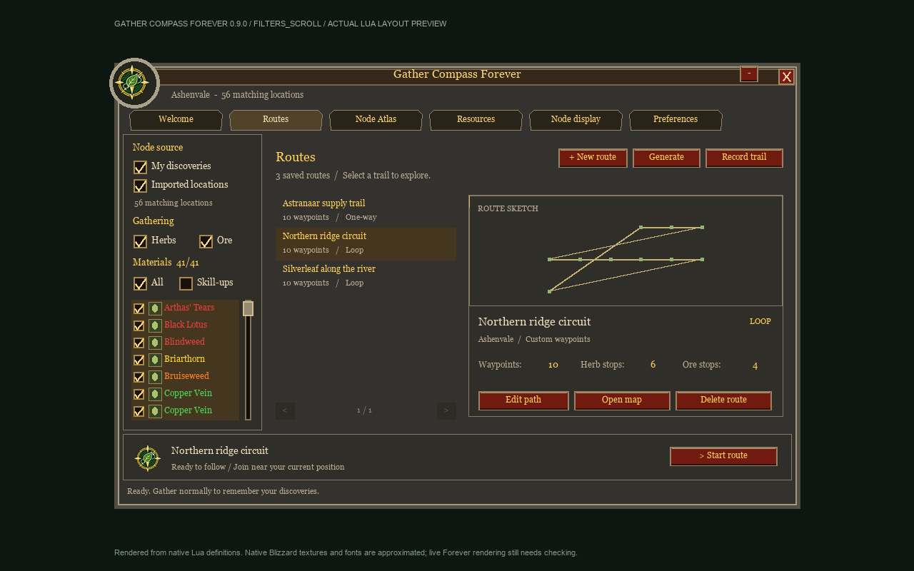
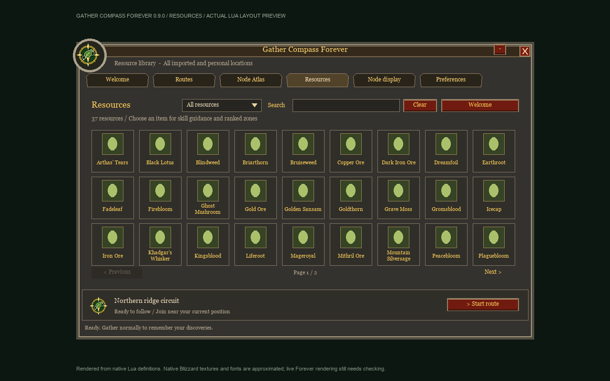
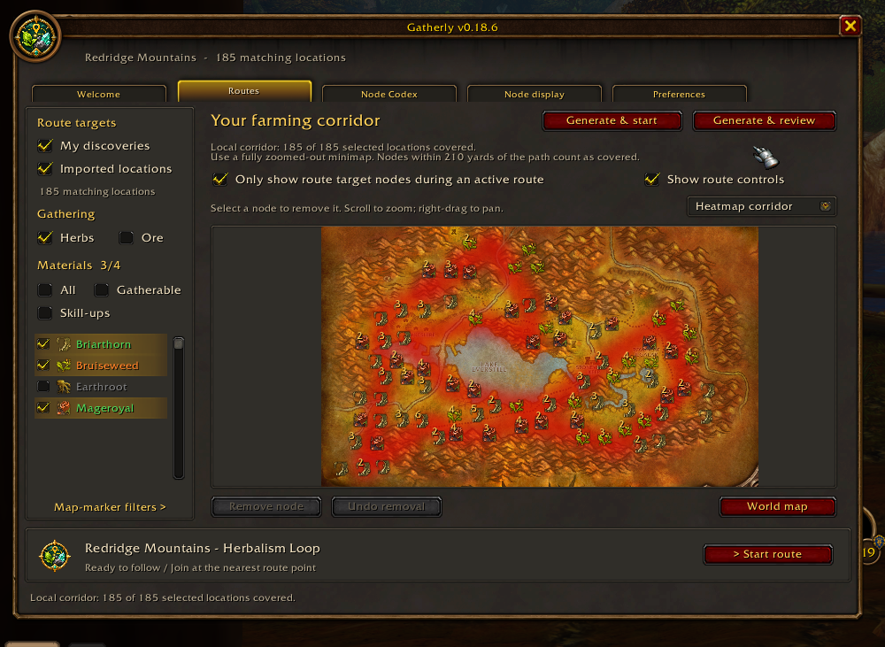
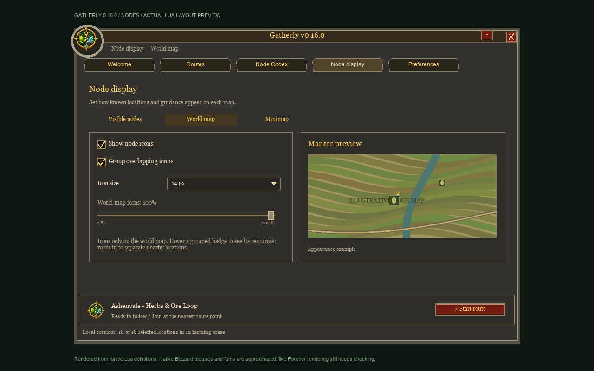

<p align="center">
  
</p>

# Gather Compass Forever

A gathering companion for **WoW Forever**: remember herb and ore locations, discover
where resources grow, build farming routes and follow a clear in-game guide arrow.

[Download the addon](https://github.com/Red463/GatherCompassForever/releases/latest) ?
[Report a bug](https://github.com/Red463/GatherCompassForever/issues) ?
[Changelog](CHANGELOG.md) ? [Contributing](CONTRIBUTING.md)


**Current version:** 0.10.0 ? **Client interface:** 16001 ? **Command:** `/gcf`

## What it does

- **Remember your discoveries.** Record a known location after a successful gather,
  keeping personal history separate from imported data.
- **Import all zones.** Read installed GatherMate2_Data directly, with GatherMate2's
  saved observations as a fallback. Repeated imports merge matching locations.
- **Choose what to farm.** Filter by source, herbs/ore and individual materials, with
  shared checkboxes for maps and generated routes, a scrolling material list and
  one-time Gatherable (including grey) or Skill-ups material selection.
- **Generate a local corridor.** Start immediately, or review a large zone map and
  remove individual nodes with undo. No save step is needed.
- **Follow the path.** Choose thin lines or a soft heatmap corridor on the world map
  and route sketch. A smooth gold arrow guides the same route. Optionally show the next resource, waypoint progress and lap number.
- **Explore resources.** Browse a square item grid and view zones ranked by known
  node count, source-specific skill requirements and personal gather history.
- **Tune map markers.** Use icons on the world map and icons, rings or squares on
  the minimap. Hide nearby minimap icons while retaining hollow outlines.
- **Review without losing history.** Removals affect the current plan only. Existing
  saved routes and node history are preserved. A minimap badge opens the panel.

## Install

1. Download `GatherCompassForever-0.10.0.zip` from
   [Releases](https://github.com/Red463/GatherCompassForever/releases/latest).
   Choose the addon ZIP asset rather than GitHub's automatic **Source code** ZIP.
2. Close WoW and extract the `GatherCompassForever` folder into your Forever
   client's `Interface/AddOns` directory.
3. Check that the final path is
   `Interface/AddOns/GatherCompassForever/GatherCompassForever.toc`.
4. Restart WoW, enable **Gather Compass Forever** in the AddOns list, then type
   `/gcf` or click the compass badge beside the minimap.

Manual route creation, recording and the saved-route list are no longer exposed.
Existing saved routes remain in your SavedVariables.

When updating, replace the complete addon folder. **Keep SavedVariables** to retain
routes, known locations and preferences. The addon is built for Forever's interface
16001; other WoW clients are not currently supported.

### Optional node data

Install the **Forever-compatible** versions of GatherMate2 and GatherMate2_Data,
then open **Welcome** and click **Import node data**. This is the only import button.
The data pack declares GatherMate2 as a dependency,
so keep both enabled even though this addon reads the pack directly.

Importing covers all available zones regardless of your location or route filters.
No spawn dataset is included in this repository. Normal personal recording works
without an external data pack.

## Image examples

These are **layout previews rendered from the addon's Lua UI**, with substitute
fonts, placeholder resource icons and an illustrative map canvas. They are not
in-game screenshots; actual Forever textures and rendering can differ.

### Welcome and shared filters

Welcome introduces the workflow, imports all available zones and shows import status.
It appears on first use; guide-arrow clicks still open Routes directly.


Source and Gathering use independent checkboxes. The material list supports mouse-wheel
scrolling and a scrollbar, with icons and skill-coloured names.



### Generate and review

Choose materials, then use **Generate & start** or **Generate & review**. Click a node
to select it, then **Remove node** to update the corridor. **Undo removal** restores
it. Scroll to zoom and right-drag empty map space to pan. Dim icons are outside the
current local circuit; counts show the included and omitted locations.


### Resource catalogue and details

Filter the full supported item catalogue by type or name. Click an item to compare
its known zones and read gathering requirements. Items without known locations
remain visible so you can plan what to seek next.




### Heatmap corridor

Select **Heatmap corridor** above the route sketch to replace the lines with a soft,
warm band through the generated farming areas. It is a route view, rather than a
live resource scanner. The arrow follows the same points; switching views does not
regenerate the route. Minimap route lines are hidden in this view, while resource
markers and the destination marker remain.



### Guide arrow

The gold arrow rotates smoothly. Enable **Show next node name** and **Show route
step and lap** in Preferences when useful. Click the arrow to reopen the route panel;
dragging it moves the guide instead. Starting a route closes the panel automatically.

The waypoint arrival distance in Preferences applies immediately to the current
route. Guidance waits during gathering; nearby overlapping stops retain movement
protection so a stationary player cannot repeatedly advance through a loop.


## First farming loop

1. Gather a few nodes or import node data from **Welcome**.
2. In **Routes**, tick your node sources, gathering types and materials.
3. Click **Generate & start** for quick guidance, or **Generate & review** to inspect it.
4. In review, select unwanted nodes and use **Remove node** or **Undo removal**.
   Choose **Route lines** or **Heatmap corridor**, then **Start route**.
5. Follow the arrow. Pause, skip or stop through the panel; click the arrow to reopen it.
   Resume rejoins nearby and leaves guidance paused if the farming area is too far away.

Path overlays appear while following (including when paused) or reviewing the current
plan. Stopping or completing guidance clears them. Generation starts at the nearest
selected local node and builds connected farming areas, rather than forcing a whole
zone into one circuit. The displayed counts show when other areas are omitted.

The **Node Atlas** provides per-resource location browsing, zone comparisons,
resource-specific route review and nearest-location guidance. The separate
**Resources** tab provides the full item catalogue, independent of your route filters.
Clicking a ranked zone temporarily focuses that resource on the world map, subject
to your shared checkbox filters. Closing the map restores its usual display.

## Settings and commands

| Command | Action |
| --- | --- |
| `/gcf` | Open or close the panel |
| `/gcf import` | Import available herb/ore data across all zones |
| `/gcf skip` | Skip the current waypoint |
| `/gcf stop` | Stop route guidance |
| `/gcf status` | Show current status and capability/storage messages |
| `/gcf inspect` | Arm a one-shot native herb/vein tooltip capture |
| `/gcf inspect report` | Show the latest local capture |
| `/gcf inspect off` | Cancel a pending capture |

The sidebar filters this addon's node markers on both maps and new route generation
together. Tick **My discoveries**, **Imported locations**, **Herbs** and **Ore** in any
combination, then tick individual materials. Unticking every source or type gives no
matching nodes; it does not reset your choices. These selections do not change a
current plan or interrupt guidance already running. A changed-selection message
reminds you to generate again when you want the new choices applied.

**All** selects all materials; untick it to clear the selection. **Gatherable** selects
known resources your current skill can gather, including grey resources and capped
professions. **Skill-ups** selects
known orange, yellow and green materials across matching known zones once. It excludes
grey, too-difficult and unknown resources, and you can edit the result afterward.
The selected materials do not change automatically when your profession skill rises.

**Node display** controls marker appearance, difficulty colours, icon-hide distance
and minimap route visibility. Its three opacity sliders independently adjust
world-map icons, minimap icons and minimap outlines from 0% to 100%. Changes apply
immediately and are remembered. Navigation markers keep their own appearance.


**Preferences** controls arrival distance, arrow scale,
optional labels and minimap-button visibility. Use `/gcf` to restore the minimap
button if it is hidden.

## How to read the data

Known locations are **possible spawn points**, not a live node scanner. Zone
rankings reflect your imported/recorded data. Personal and imported location counts
can overlap; personal gather counts are successful interactions, not item quantities.
Recorded coordinates reflect the interaction position, which can differ from the
object's exact centre.

Skill colours use **Classic reference data**, current profession rank and readable
cap/bonus information. Unknown information stays neutral. Native tooltip inspection
is optional, stored locally and does not automatically change the skill rules.

Routes use nearby spatial groups and geometric connections of at most 450 yards,
including their return path. Dense areas use representative actual spawn locations;
the arrow does not visit every candidate individually. Disconnected or distant
areas are omitted rather than joined across the zone.

This is **not terrain pathfinding**: short connections can still cross cliffs, water,
walls or caves. Move around obstacles, skip a difficult destination, remove an
unwanted node, or regenerate from a better position. No third-party terrain engine
or navigation data is bundled. Return connectors can still show the resource name
at that coordinate in the optional next-node label. Routes are single-zone and their inputs/visuals are
bounded for performance. Entering a waypoint's arrival radius
can advance the route without a harvest. The addon does not move your character or
gather automatically, and it does not replace your native waypoint.

The current build has automated behavior/package checks and is ready for client
testing. Those checks do not prove native rendering or restricted API behavior.
Report a Lua error with the addon version, client build, zone and steps to reproduce.

## Development

See [Contributing](CONTRIBUTING.md) for setup, checks and artwork guidance.

```sh
python -m pip install -r requirements-dev.txt
python tests/run_tests.py
python tools/package.py
python tests/package.py
python tools/check_publication.py
```

Tests use Lua 5.1 through Lupa. The installable archive is generated in `dist/`;
it is not the same as GitHub's source archive. The installed addon makes no network
requests and needs no external service.

## License

Gather Compass Forever's original code, documentation and project artwork are
licensed under the [MIT License](LICENSE). Bundled third-party libraries retain
their original licenses; see [Third-party notices](NOTICE.md).

World of Warcraft and referenced native UI artwork belong to Blizzard Entertainment.
This is a community addon and is not affiliated with or endorsed by Blizzard.
